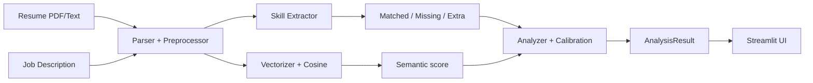

# Architecture (Phase 1 draft)

## Rules

1. The UI calls only `pipeline.analyze()`. Modules never import the UI.
2. Every stage passes data forward in the shapes defined in `schemas.py`.
3. All paths and tunable numbers live in `config.py`, never hard-coded.